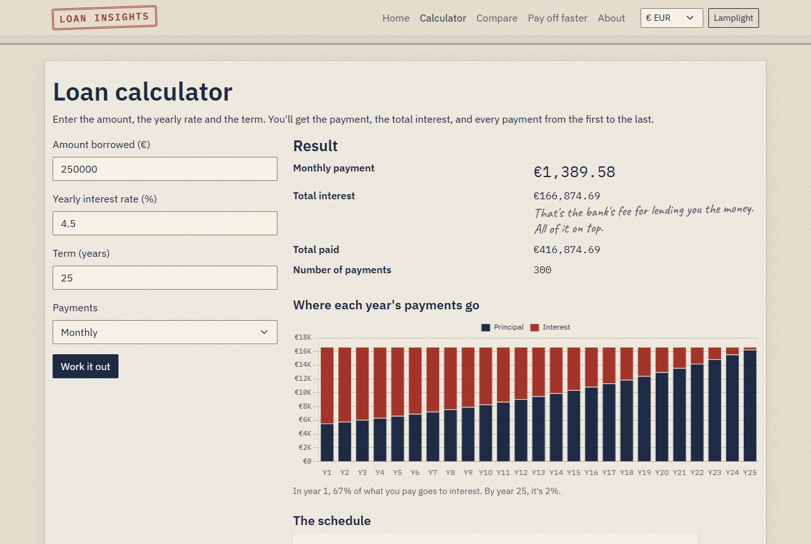
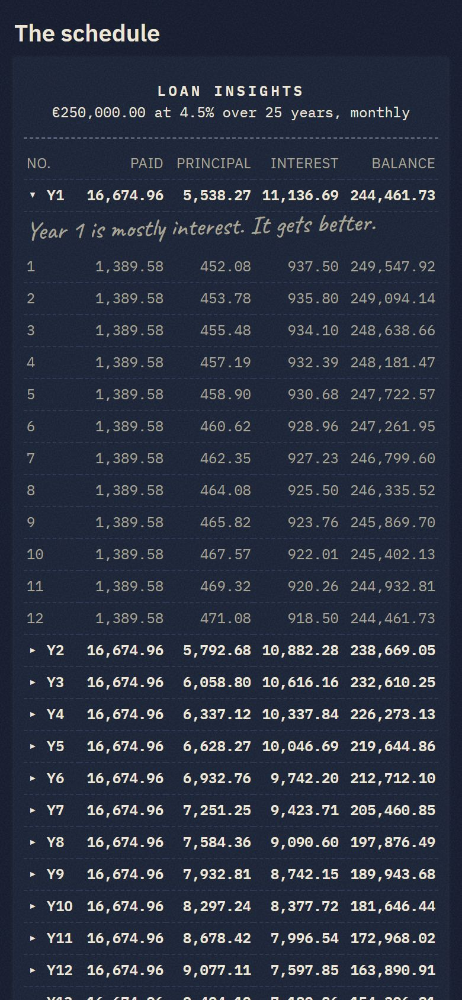
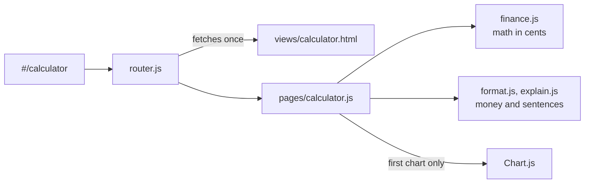

# Loan Insights

A loan calculator that shows what a loan really costs before you sign: the payment, the total interest, and every payment until the balance is zero.

[](https://github.com/An3DCu/LoanInsights/actions/workflows/ci.yml) [](LICENSE)



**[Open the live site](https://an3dcu.github.io/LoanInsights/)**

## Overview

A bank quotes you a monthly payment. What it doesn't put up front is how much of that is interest, how long it lasts, or what changes if you pay a little more. Loan Insights works that out in the browser: one loan, two loans side by side, or a loan you already have and how to pay it off sooner.

It looks like an old bank savings book: cream paper, navy ink, a red rubber stamp, and a receipt that grows with the term. A short handwritten note appears next to a result when there's something worth knowing, like "Year 1 is mostly interest. It gets better."

What I'd want a reviewer to notice is under the paper. The math works in whole cents and is tested against independent calculations (162 tests). The site is a single page with my own small router on jQuery. It scores 100 for accessibility in Lighthouse, and a Content Security Policy only lets it load its own files.

The idea and a first prototype came from a front-end course during my studies, built 100% by hand. Now, with more experience and awareness, better tools, and a more advanced AI assistant to work with, I came back to it and brought it up to the standard I'd hold it to if I were building it today.

## Features

- **Calculator:** the payment, total interest and total paid, a chart of where each year's money goes, and the full schedule as a receipt you can open year by year and tear off as a CSV.
- **Compare loans:** two offers side by side, with one plain sentence on what the difference costs.
- **Pay off faster:** what an extra amount with every payment, or paying half every two weeks, saves in time and interest.
- **Shareable results:** the numbers live in the link, so a result can be bookmarked or sent.
- **Currencies:** euro, convertible mark, dollar or pound. This changes how amounts are written, never the math.
- **Light and dark:** follows your system, or switch with Lamplight.
- **Nothing leaves your browser:** no accounts, no tracking, no server.



## Tech stack

| Piece | Choice | Why |
|---|---|---|
| Pages | One `index.html` plus HTML fragments in `views/`, swapped in by my own hash router | Works on any static host; back, forward and refresh keep you on the right page |
| DOM and events | jQuery 4 | Event delegation keeps forms working each time a page is swapped back in |
| Look | Bootstrap 5.3, built from Sass with my own variables | The theme comes from Bootstrap's own variables, and only the parts in use are built (122 KB of CSS, down from the original 340 KB) |
| Math | A plain JavaScript module with no DOM | Every number can be tested in Node on its own |
| Charts | Chart.js 4 | Loaded only when a chart is drawn |
| Fonts | IBM Plex Sans and Mono, Caveat | Served from the site itself, so the page makes no outside requests |
| Tests | `node --test` | Built into Node, no test framework to install |
| CI and hosting | GitHub Actions, GitHub Pages | Every pull request is tested and built; `main` is published |

## Architecture

The page loads once. Changing the address after `#` makes the router fetch that page's HTML fragment (cached after the first time), swap it in, and call the page's module. The module reads the form, hands the numbers to the math, and writes the result back as text.



```text
index.html     the one page: header, nav, footer, and the space pages are swapped into
views/         one HTML fragment per page
js/
  router.js    the hash router
  finance.js   loan math in whole cents; no DOM, so it's tested in Node
  format.js    reading and writing money and numbers
  explain.js   the result sentences and margin notes
  pages/       one module per page, and the form handling they share
scss/          Bootstrap's variables, my components, the paper texture, the receipt
scripts/       copies the libraries into vendor/, draws the banknote pattern
tests/         node --test
```

## Getting started

### Prerequisites

- [Node.js](https://nodejs.org/) 22 or newer
- [Python 3](https://www.python.org/), or any other static file server

### Setup

```powershell
git clone https://github.com/An3DCu/LoanInsights.git
cd LoanInsights
npm ci
npm run build
```

`npm run build` copies the libraries and fonts into `vendor/` and compiles the Sass into `css/`. Neither folder is committed. If PowerShell says running scripts is disabled, use `npm.cmd` instead of `npm`.

### Run

```powershell
python -m http.server
```

Then open http://localhost:8000. Opening `index.html` straight from disk won't work, because the pages are fetched. While changing styles, run `npm run watch:css` in a second terminal.

### Tests

```powershell
npm test
```

## Key engineering decisions

| Decision | Why | Trade-off |
|---|---|---|
| My own hash router instead of spapp | About 60 lines on jQuery: fragments cached, the title and active link updated, focus moved to the new heading, a 404, and a cleanup hook so charts are destroyed when you leave | Addresses look like `#/calculator`, but GitHub Pages needs no rewrite rules |
| Bootstrap built from Sass | The look comes from Bootstrap's own variables instead of fighting its CSS, and unused components and utilities are left out | A build step before the site runs |
| Money in whole cents | Decimals like 0.1 can't be stored exactly, so adding up 300 rows drifts. Cents don't. The last payment absorbs the rounding, so the balance ends at exactly 0.00 | Every amount is converted on the way in and out |
| Two bi-weekly models | True bi-weekly (26 payments at a 26th of the yearly rate) on the Calculator and Compare; accelerated bi-weekly (half the monthly payment every two weeks) on Pay off faster. They answer different questions | Two similar names, which the About page explains |
| Libraries served from the site, not a CDN | Exact pinned versions, copied from `node_modules`, so the CSP can be `'self'` | The site carries its own copy of each library |
| A Content Security Policy in a meta tag | Only the site's own files can run or load, with no `'unsafe-inline'`. GitHub Pages can't send headers, so it's a meta tag | A meta tag can't set `frame-ancestors`, so the site could still be shown inside another page |
| No login | A login checked in the browser can't protect anything, and there's nothing to protect: nothing leaves the browser | Results don't follow you to another device, except by sharing the link |

## Limitations

- Fixed-rate loans only. No fees, insurance, variable rates or payment holidays.
- The currency menu changes how amounts are written; it doesn't convert between currencies.
- Amounts up to 10 billion, rates up to 100% and terms up to 100 years, so every total stays exact in cents.
- English only.

## Roadmap

- [ ] End-to-end tests with Playwright for the three calculators
- [ ] A print stylesheet for the schedule
- [ ] One page ported to plain JavaScript, with a short comparison

## Credits and license

- [jQuery](https://jquery.com/), [Bootstrap](https://getbootstrap.com/) and [Chart.js](https://www.chartjs.org/), under the MIT license.
- [IBM Plex](https://github.com/IBM/plex) and [Caveat](https://github.com/googlefonts/caveat), under the SIL Open Font License 1.1. The license files are copied next to the fonts.
- The paper grain, the banknote pattern and the favicon are drawn by code in this repo.
- My code is under the MIT license. See [LICENSE](LICENSE).

## Contact

Anad Čuruković · [an3dcu.github.io](https://an3dcu.github.io) · [LinkedIn](https://linkedin.com/in/anadcurukovic) · ancur26@proton.me
